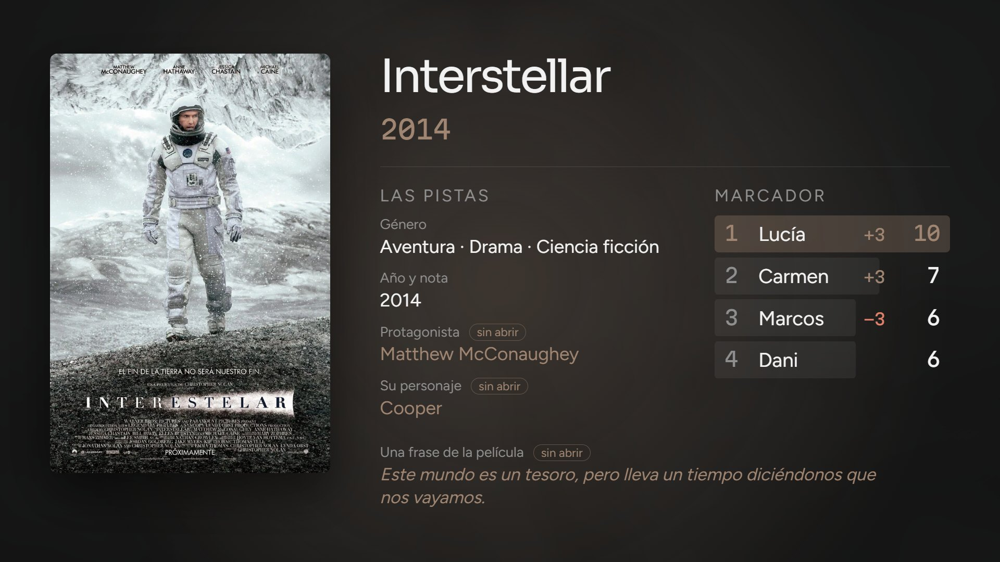
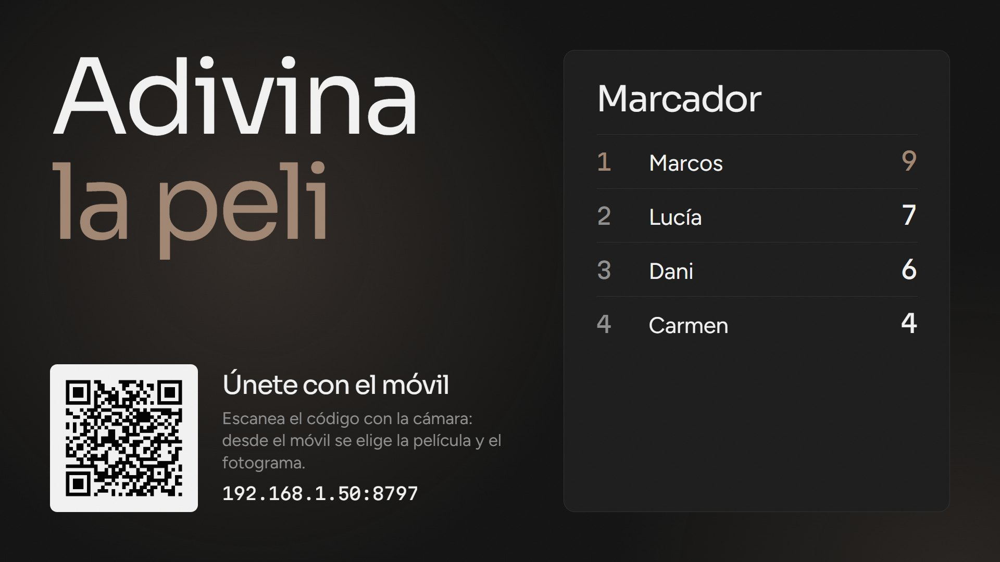
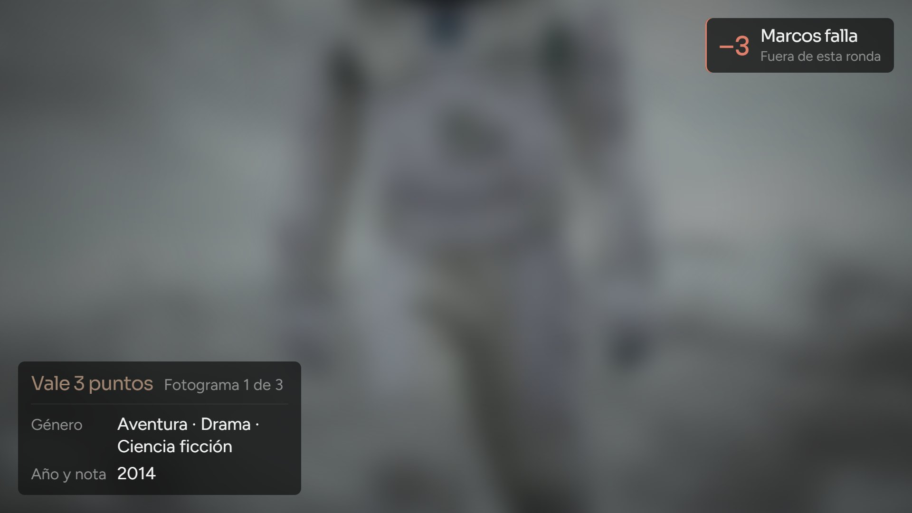
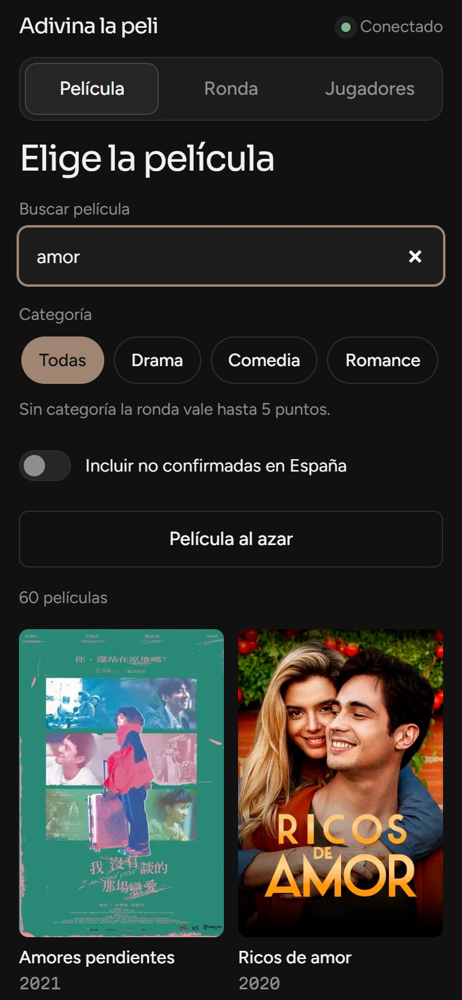
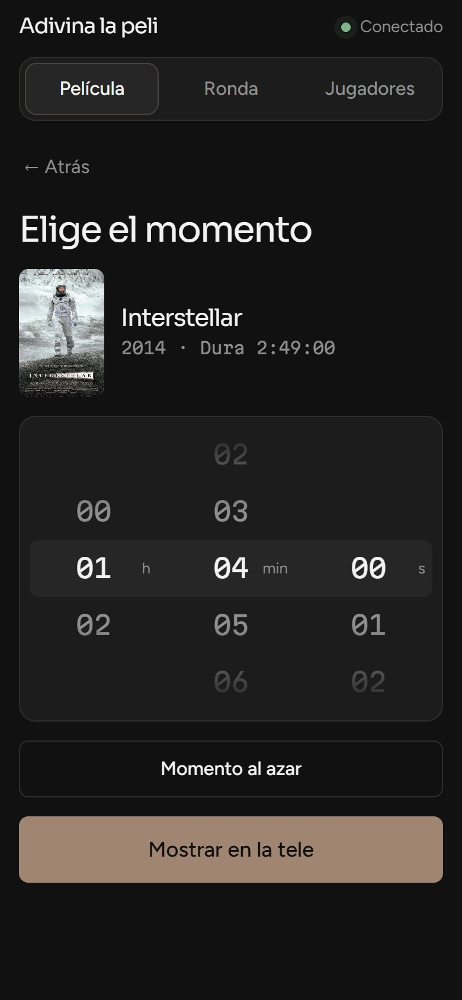
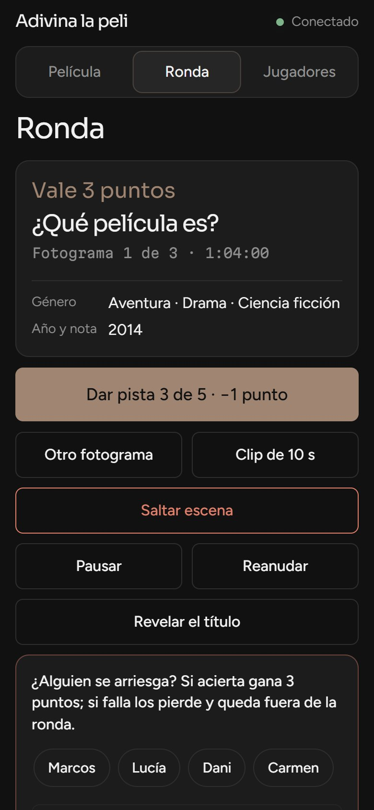
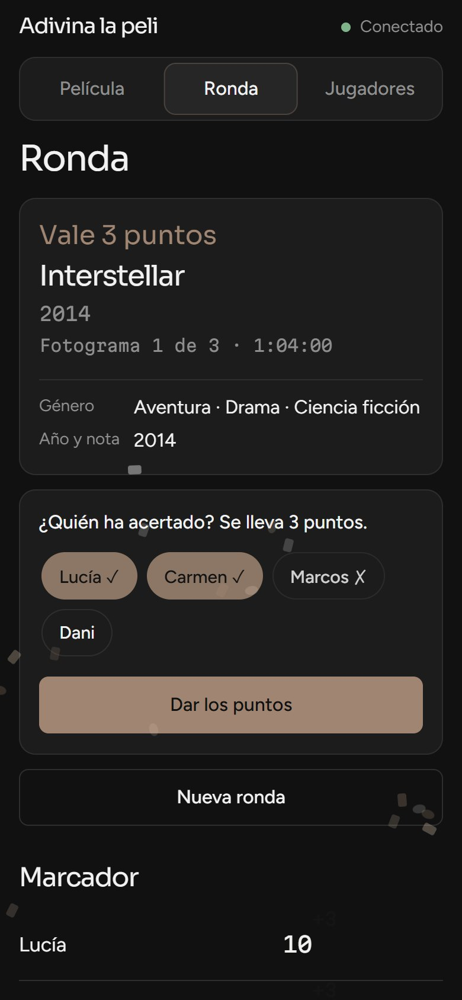
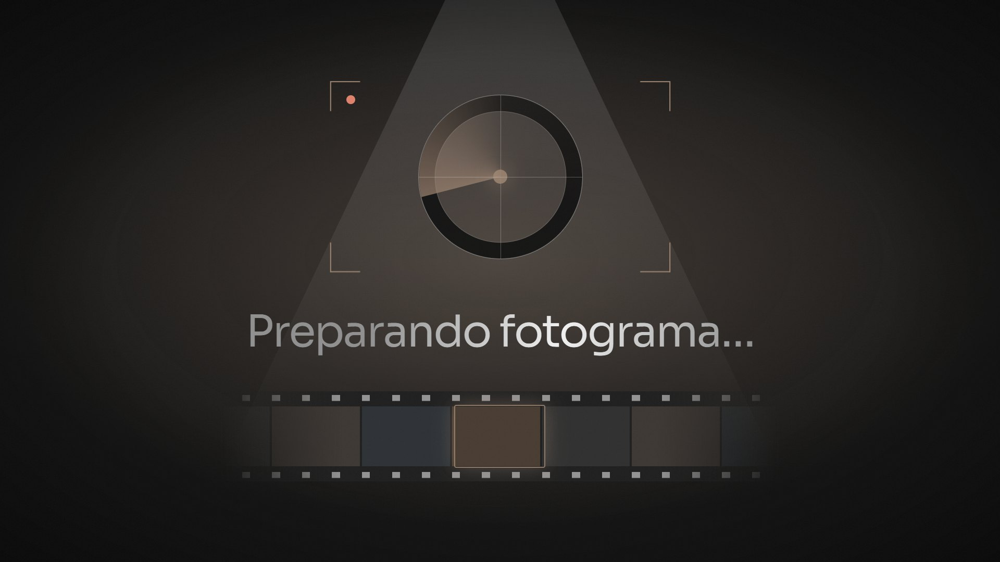

# Adivina la Peli

Juego de salón: desde el móvil se elige una película del catálogo de Netflix España y un instante exacto (hh:mm:ss). El PC abre esa película en Netflix justo en ese segundo, la pausa y oculta cualquier pista (título, barra de progreso). Los jugadores adivinan, y «Revelar» enseña el título y el póster. La pantalla del PC se transmite a la tele con una app externa (fuera de este proyecto).

> La app **no descarga, graba ni captura** vídeo ni fotogramas. Solo controla la reproducción normal de Netflix con tu cuenta.

**[⬇️ Descargar la última versión](https://github.com/josecarlos712/FilmGuess/releases/latest)**: un .zip para Windows con todo incluido, sin instalar Python.

## Capturas

<p align="center">
  
</p>
<p align="center"><em>Al revelar, la tele enseña el póster, el título, todas las pistas (también las que nadie abrió) y cómo queda el marcador.</em></p>

| La tele en espera | Pistas durante la ronda | Alguien se arriesga y falla |
|---|---|---|
|  |  |  |
| Se escanea el QR con el móvil y se ve el marcador. | Las pistas abiertas van en una esquina y la escena queda libre. | Aciertos y fallos salen como avisos pequeños. |

| Elegir la película | Elegir el momento | Dar pistas | Repartir puntos |
|---|---|---|---|
|  |  |  |  |

<p align="center">
  
</p>
<p align="center"><em>Mientras Netflix busca el segundo elegido, la tele enseña una sala de proyección en lugar de la carga de Netflix.</em></p>

> En las capturas, la «escena» es el póster desenfocado: el juego se fotografió con una tele de prueba (`scripts/capturas_readme.py`), sin Netflix ni fotogramas reales.

## Cómo se juega

1. En el PC: `arrancar.bat`. Se abre Edge a pantalla completa con la pantalla de espera (logo, QR y marcador). Transmítela a la tele.
2. En el móvil (misma wifi): escanea el QR de la tele.
3. **Película**: busca un título o pulsa «Película al azar» (el título queda oculto también para quien elige). Opcionalmente elige una **categoría** (Ciencia ficción, Drama, Terror…): el género se sabe gratis, pero la ronda vale como máximo 3 puntos.
4. **Momento**: gira la rueda de horas, minutos y segundos (o «Momento al azar») y pulsa «Mostrar en la tele». En unos segundos la tele muestra ese fotograma, pausado y sin pistas.
5. **Ronda**: acertar vale **5 puntos** (3 con categoría). Cada **pista** resta 1 punto, hasta un mínimo de 1, y aparece en una esquina de la tele sin tapar la escena:

   | Sin categoría (5 → 1) | Con categoría (3 → 1) |
   |---|---|
   | 1. Género | *(gratis: la categoría)* |
   | 2. Año y nota de IMDb | 1. Año y nota de IMDb |
   | 3. Actor o actriz principal | 2. Protagonista y su personaje |
   | 4. Su personaje | 3. Frase célebre, crítica, sinopsis o director (gratis) |
   | 5. Frase célebre, crítica, sinopsis o director (gratis) | |

   Gratis en cualquier momento: **otros dos fotogramas** al azar (tres en total) y un **clip de 10 segundos**. Si sale una escena delicada, **Saltar escena** tapa la tele al instante y cambia a otro momento sin gastar fotograma.
6. **Arriesgarse**: quien se lanza a decir un título corta a los demás. Coge el móvil, se marca en «¿Alguien se arriesga?» y pulsa «Ver el título solo en este móvil»: el título aparece en el teléfono, nunca en la tele. Si pulsa «Ha acertado», la tele revela la película y se lleva los puntos. Si pulsa «Ha fallado», pierde lo que valía la ronda en ese momento y queda fuera de esa ronda (ya no puede recibir puntos); como ya conoce el título, pasa a llevar el móvil: da las pistas y cambia los fotogramas para los demás. El marcador puede quedar en negativo.
7. **Revelar el título** termina la ronda: marca quién ha acertado y pulsa «Dar los puntos». El marcador se ve en la tele y se guarda entre partidas; «Corregir puntos a mano» permite ajustarlo.
8. **Jugadores**: añade, renombra o quita jugadores y pon el marcador a cero.

## Instalación paso a paso (Windows)

### 1. Requisitos

| Necesitas | Para qué |
|---|---|
| **Python 3.11 o posterior** ([python.org](https://www.python.org/downloads/)) | La app del PC |
| **Microsoft Edge** (viene con Windows) o Google Chrome | Reproducir Netflix con su DRM. Firefox no sirve |
| **Cuenta de Netflix** | La reproducción |
| **Clave de API de TMDB** (gratis) | Títulos en español, pósters, duración y disponibilidad en España |
| `movies.csv` con las películas de Netflix (`"Título",IDdeNetflix` por línea) | El catálogo de partida |

### 2. Descargar e instalar

Abre una terminal en la carpeta donde quieras el juego:

```bash
git clone https://github.com/josecarlos712/FilmGuess.git
```

```bash
cd FilmGuess
```

```bash
python -m venv .venv
```

```bash
.venv\Scripts\python.exe -m pip install -e "pc-app[dev]"
```

> No hace falta descargar navegadores de Playwright: la app usa el Edge (o Chrome) que ya tienes instalado.

### 3. Configuración

`config.toml` se crea automáticamente en el primer arranque (se copia `pc-app/config.example.toml` a `pc-app/config.toml` y se genera el código de conexión del móvil). También puedes crearlo a mano con:

```bash
arrancar.bat config
```

La clave de TMDB (`[tmdb] api_key`) es **opcional**: solo hace falta para importar, corregir o añadir películas. Ese fichero no se sube a Git: guarda la clave y el código de conexión.

Si tu cuenta de Netflix tiene varios perfiles, pon el que se usará en `[netflix] profile_name = "..."` (sin importar mayúsculas ni acentos).

> **Solo si quieres ampliar el catálogo:** consigue la clave de TMDB. Crea una cuenta gratuita en [themoviedb.org](https://www.themoviedb.org/), ve a **Ajustes → API**, copia el **token de lectura de la API (v4)** o la **clave de la API (v3)** y pégala en `[tmdb] api_key = "..."` de `pc-app/config.toml`.

### 4. Catálogo

La app incluye un catálogo listo (`pc-app/catalogo/catalogo-base.sqlite.gz`: ~52.800 películas, 3.525 con pistas) que se instala solo en `data/catalogo.sqlite` en el primer `arrancar.bat` si todavía no hay catálogo. No hay nada que importar para jugar.

Para ampliarlo o actualizarlo (necesita la clave de TMDB):

1. Copia tu `movies.csv` en `data/movies.csv`.
2. Importa (empareja cada película con TMDB, enlaza los IDs de Wikidata y aplica las notas de IMDb; tarda un rato la primera vez y se puede interrumpir y reanudar):

   ```bash
   arrancar.bat importar --descargar-wikidata --descargar-imdb
   ```

   Las siguientes veces basta con `arrancar.bat importar`, o con el botón **Importar o actualizar** del panel.

3. Descarga las pistas (géneros, reparto y frase célebre o crítica) de las películas que se pueden jugar; tarda unos minutos y solo procesa las que aún no las tienen:

   ```bash
   arrancar.bat pistas
   ```

   Las frases salen de Wikiquote; si no hay, una crítica de TMDB, el eslogan, la sinopsis con el título tapado o, como último recurso, quién la dirige. En las pistas se tapa cualquier palabra del título. Las que llegan en inglés se muestran en español gracias a `data/traducciones.json` (texto original + traducción), que se reutiliza en cada descarga mientras el original no cambie. Para traducir textos nuevos: `arrancar.bat pistas --exportar-sin-traducir pendientes.json`, añade sus traducciones al fichero y aplica con `arrancar.bat pistas --aplicar-traducciones`.

Para refrescar el catálogo incluido ejecuta `arrancar.bat exportar-catalogo`: elimina el historial de partidas y las notas de IMDb, porque los datos de IMDb son solo para uso personal (`--con-imdb` las conserva; no es para compartir). Sin notas de IMDb la película al azar se elige por los votos de TMDB. Los pósters se siguen cargando desde image.tmdb.org (necesita internet, no clave).

### 5. Primer inicio de sesión en Netflix

La app usa un perfil de Edge propio (`data/browser-profile`), así que la sesión de tu Edge normal no sirve: hay que iniciarla una vez en el suyo.

```bash
arrancar.bat netflix-login
```

Se abre una ventana de Edge: inicia sesión en Netflix, elige el perfil y **cierra la ventana**. La sesión queda guardada y sobrevive a los reinicios del PC. Si algún día caduca, el móvil lo avisa y puedes repetirlo desde el panel (**Abrir Netflix para iniciar sesión**).

### 6. Jugar

```bash
arrancar.bat
```

- La consola muestra el QR y el enlace para el móvil.
- El **panel del PC** está en [http://localhost:8765/panel](http://localhost:8765/panel): estado, QR, cambiar el código de conexión, importación, corrección de emparejamientos y alta de películas por enlace.
- La primera vez, Windows puede preguntar si permite a Python usar la red: acepta en **redes privadas** para que el móvil pueda conectarse.

## Si algo falla

| Síntoma | Qué hacer |
|---|---|
| **La tele muestra el vídeo en negro** al transmitir (el PC sí lo ve) | Es la protección DRM por hardware. Pon `disable_gpu = true` en `[browser]` de `config.toml` y reinicia. Si sigue en negro, prueba Chrome (`channel = "chrome"`) o conecta la tele por HDMI. |
| El móvil no conecta | Misma wifi que el PC, permiso de red de Python en redes privadas y el QR actual (si cambiaste el código en el panel, vuelve a escanearlo). |
| «Netflix ha cerrado la sesión» | Panel → **Abrir Netflix para iniciar sesión**, inicia sesión y pulsa **Volver a la pantalla de espera**. |
| «Netflix pide elegir perfil» | Pon el nombre en `[netflix] profile_name` y reinicia. |
| «Esta película no está disponible aquí» | Netflix la ha retirado en España: la app la marca y deja de proponerla al azar. |
| Una película tiene el póster o el título equivocado | Panel → **Emparejamientos para revisar** → pega el enlace correcto de TMDB. |
| Falta una película que sí está en Netflix | Panel → **Añadir película por enlace** (enlace de Netflix + ficha de TMDB). |

## Comandos

| Comando | Qué hace |
|---|---|
| `arrancar.bat` | Arranca el servidor y el navegador de la tele (igual que `arrancar.bat servir`) |
| `arrancar.bat importar` | Importa o actualiza el catálogo (`--limite N`, `--sin-tmdb`, `--sin-imdb`, `--descargar-imdb`, `--descargar-wikidata`) |
| `arrancar.bat pistas` | Descarga las pistas del catálogo de juego (`--todas` para rehacerlas, `--limite N`, `--exportar-sin-traducir FICHERO`, `--aplicar-traducciones`) |
| `arrancar.bat netflix-login` | Abre el perfil de la app para iniciar sesión en Netflix |
| `arrancar.bat plataformas` / `exportar-plataformas` | Catálogo de todas las plataformas en España y su CSV (estudio aparte) |
| `arrancar.bat config` | Muestra la configuración efectiva (sin la clave) |

## Desarrollo

Desde `pc-app/`:

```bash
..\.venv\Scripts\python.exe -m pytest -q
```

```bash
..\.venv\Scripts\python.exe -m ruff check .
```

```bash
..\.venv\Scripts\python.exe -m mypy src/
```

## Documentación

| Documento | Contenido |
|---|---|
| [docs/01-decisiones.md](docs/01-decisiones.md) | Decisiones tomadas y en qué se aparta de la especificación original |
| [docs/02-arquitectura.md](docs/02-arquitectura.md) | Componentes, API, WebSocket, tele, móvil y panel |
| [docs/03-catalogo.md](docs/03-catalogo.md) | Cómo se construye el catálogo: CSV + Wikidata + TMDB + IMDb |
| [docs/04-diseno.md](docs/04-diseno.md) | Pantallas e interfaz |
| [docs/05-plan.md](docs/05-plan.md) | Fases, pruebas y riesgos |
| [docs/06-aceptacion.md](docs/06-aceptacion.md) | Prueba de aceptación y su resultado |

## Estructura

```
FilmGuess/
├── pc-app/        Servidor FastAPI, control de Edge con Playwright, catálogo, tele (web/tv) y panel (web/panel)
├── mobile-app/    Web del móvil (HTML/CSS/JS sin compilación) que sirve el propio PC en /m/
├── data/          Catálogo SQLite, movies.csv, perfil del navegador y marcador (no se versiona)
└── docs/          Documentación
```

## Licencia

Adivina la Peli se distribuye con la licencia **[PolyForm Noncommercial 1.0.0](LICENSE.md)**:

- ✅ Puedes descargarlo, usarlo y jugar gratis.
- ✅ Puedes estudiar el código, modificarlo y compartir tus cambios, siempre que no sea con fines comerciales.
- ❌ No puedes venderlo, ni venderlo modificado, ni usarlo en un producto o servicio de pago.
- ⚠️ Quien lo comparta, modificado o no, tiene que incluir la licencia y el aviso de autoría del fichero [NOTICE](NOTICE).

Para un uso comercial hace falta un permiso aparte del autor.

## Créditos y atribuciones

- **TMDB:** este producto usa la API de TMDB, pero TMDB no lo respalda ni lo certifica. Los títulos en español, los pósters, las duraciones, las sinopsis, los eslóganes y las críticas del catálogo vienen de [The Movie Database (TMDB)](https://www.themoviedb.org/). Los pósters se cargan directamente desde los servidores de TMDB.
- **Wikiquote:** las frases de películas marcadas como de Wikiquote vienen de [Wikiquote](https://es.wikiquote.org/), con licencia [CC BY-SA 4.0](https://creativecommons.org/licenses/by-sa/4.0/deed.es). Cada frase pertenece a la página de Wikiquote de su película y a sus autores; el juego solo tapa las palabras del título.
- **Wikidata:** los enlaces entre identificadores (Netflix, TMDB e IMDb) vienen de [Wikidata](https://www.wikidata.org/), con licencia [CC0](https://creativecommons.org/publicdomain/zero/1.0/deed.es).
- **IMDb:** las notas de IMDb solo se usan si cada persona descarga los [conjuntos de datos de IMDb](https://developer.imdb.com/non-commercial-datasets/) en su propio PC, para uso personal y no comercial. El catálogo incluido en el repositorio y en el paquete **no lleva datos de IMDb**.
- **Fuentes:** Sora, Figtree y Martian Mono, de [Google Fonts](https://fonts.google.com/), con licencia [SIL Open Font License](https://openfontlicense.org/).

Los títulos, pósters y frases de las películas son propiedad de sus respectivos dueños y se muestran solo como parte del juego.

## Aviso

Adivina la Peli es un proyecto **no oficial** y sin ánimo de lucro. **No tiene ninguna relación con Netflix**, ni está patrocinado ni respaldado por Netflix. «Netflix» es una marca registrada de Netflix, Inc.

El juego no descarga ni copia vídeo: controla el reproductor de Netflix en el navegador de cada persona, con su propia cuenta y su propia suscripción. Cada jugador es responsable de usarlo de acuerdo con las [condiciones de uso de Netflix](https://help.netflix.com/legal/termsofuse).
